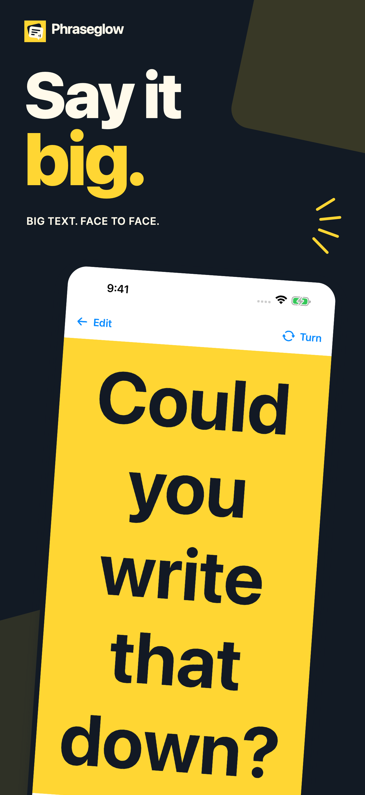
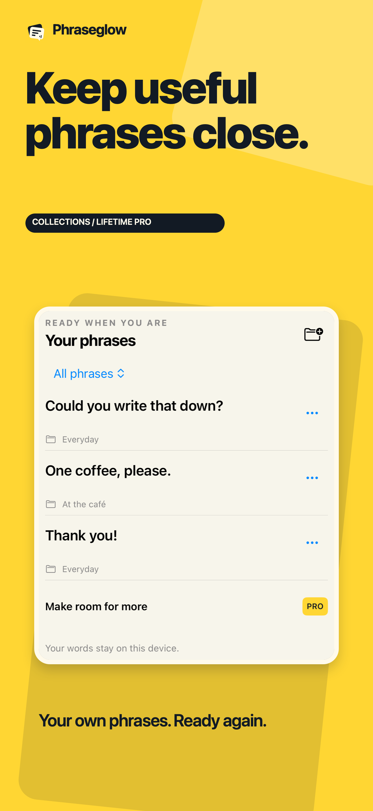
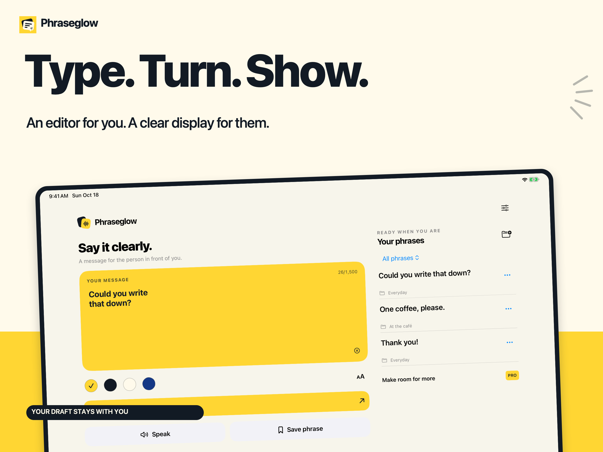

# Phraseglow · Big Text Cards

**Your words, a little clearer.** A native iPhone and iPad app for everyday face-to-face communication: type a message, show readable large text, turn it toward someone opposite, and optionally speak it with an installed Apple voice.

**Status: app1.0(1) and Lifetime Pro submitted together on October18,2026; both Waiting for Review. V1 frozen; not released.**

## The campaign

Five art-directed frames for each device family, built around authentic final native UI. Collections and saved styles are clearly labeled as Lifetime Pro features.

 

[Full iPhone campaign](assets/iPhone-campaign.png) · [Dedicated iPad campaign](assets/iPad-campaign.png)

## The product
Free unlimited text display and system speech, all high-contrast palettes, and three saved phrases. A one-time Lifetime Pro purchase adds more saved phrases, named collections and saved presentation styles. Existing content stays readable and usable after entitlement changes. No account, backend or subscription. No translation or medical/treatment claims.

## Deliberate engineering
- Explicit editor and presentation modes preserve the draft. A180-degree turn changes the recipient's reading direction while controls stay reachable.
- UIKit measures native glyphs. Short messages grow; long messages scroll at a readable minimum instead of becoming tiny. Unicode, natural bidirectional text and multiline content are preserved.
- Versioned Codable storage uses atomic writes, keeps a previous generation and preserves unreadable documents. Save failures remain visible and retryable.
- StoreKit2 uses localized pricing and verified transactions, with restore, cancellation, pending, error, refund and offline/relaunch handling.
- AVSpeechSynthesizer uses installed voices, stops on interruption/background/headphone removal, and guards against stale callbacks from replaced utterances.
- A purposeful iPad workspace puts editing and phrase recall side by side, with stacked layouts for narrow windows.

## Validation boundaries

Automated core/data-integrity/local StoreKit tests and iPhone/iPad workflows passed. Physical iPhone tests verified native speech completion, speaker routing, stale-callback rejection and injected interruption/route-change handlers; no subjective listening claim is made. A genuine physical App Store catalog lookup returned the correct non-consumable SKU and localized price. The publisher explicitly waived remaining remote Sandbox purchase/entitlement/restore/offline verification after a failed initial purchase attempt. Those remote checks are skipped, not passed. TestFlight is separately skipped by publisher instruction. iOS15 deployment compiles; an iOS15 runtime was unavailable, and the oldest available runtime check used iOS17.

## Technology and privacy
Swift · SwiftUI · UIKit/TextKit · AVFoundation · StoreKit2 · XCTest/XCUITest · Universal iOS/iPadOS15+. No third-party runtime dependencies. The developer collects no messages, phrases or usage analytics. Local content remains on the device; Apple handles system speech and purchases. Offline speech availability depends on installed voice resources.

The commercial source repository is private. This public showcase contains reviewed product documentation and artwork only. Compilation, automated tests, device execution and Apple submission are recorded separately; no download, revenue, ranking or acceptance guarantee is claimed.

[Privacy](https://sepidehdalir.github.io/phraseglow/privacy.html) · [Support](https://sepidehdalir.github.io/phraseglow/support.html) · [Portfolio](https://github.com/sepidehdalir/ios-app-portfolio)

Designed and engineered by **Sepideh Javanbakht Dalir** · [Arvinify](https://www.arvinify.com) · [hello@arvinify.com](mailto:hello@arvinify.com)
